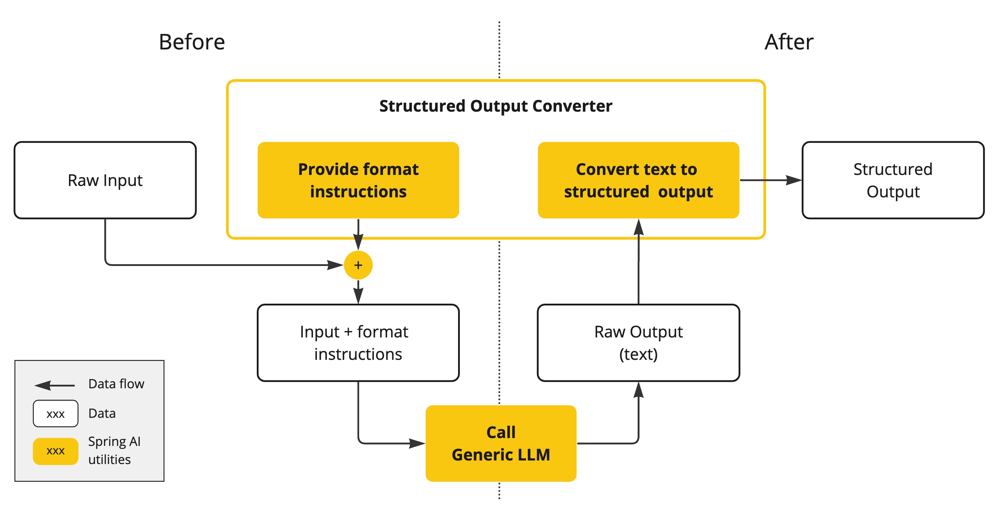
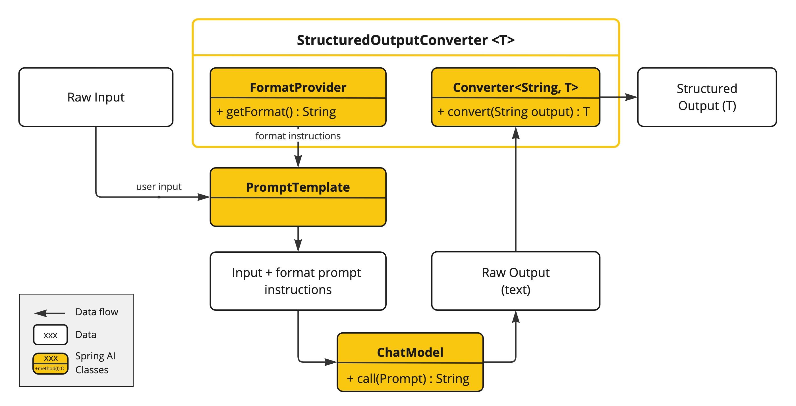

# 结构化输出转换器
`entity()`构建在`StructuredOutputConverter`之上，当你需要：
- 解析内置转换器拒绝的输出
- 非json格式的输出
- 直接使用转换器对`ChatModel`API进行转换

时，可直接通过`entity()`来实现

Spring AI的`StructuredOutputConverter`的原理为：
1. 用户输入
2. StructuredOutputConverter对用户输入进行包装，结合到提示词中发给模型
3. 模型原生输出
4. StructuredOutputConverter对模型输出进行转换，生成最终输出



## 结构化输出API
Spring AI通过`StructuredOutputConverter`来实现输入的格式限制与输出转换

接口定义为：
```java
public interface StructuredOutputConverter<T> extends Converter<String, T>, FormatProvider {

    /**
     * Returns the JSON schema for the structured output of an LLM call,
     * or NO_JSON_SCHEMA ("") if not available.
     */
    default String getJsonSchema() {
        return NO_JSON_SCHEMA;
    }

}
```

其中`Converter<String, T>`用于对模型输出进行转换，FormatProvider用于给模型输入提供格式限制的说明，后者通常是结合提示词模板`PromptTemplate`进行使用



`getJsonSchema()`为提供的默认方法，`useProviderStructuredOutput()`和`validateSchema()` 通过该默认方法来识别应该使用那种输出格式

## 提供的结构化输出转换器
Spring AI提供了如下的结构化输出转换器：


- `AbstractConversionServiceOutputConverter<T>`：通用对话转换器
- `AbstractMessageOutputConverter<T>`：通用消息转换器
- `BeanOutputConverter<T>`：类转换器
- `MapOutputConverter`：Map转换器
- `ListOutputConverter`：List转换器

### BeanOutputConverter\<T>
ActorsFilms：
```java
public record ActorsFilms(String actor, List<String> movies) {
}
```

#### 隐式使用
在`entity()`中指定类使用的就是该转换器：
```java
@RestController
public class MyController {
    @Resource
    private ChatClient chatClient;

    @PostMapping("/ai")
    public ActorsFilms generate() {
        return chatClient.prompt()
                .user(u -> u.text("Generate the filmography of 5 movies for {actor}.")
                        .param("actor", "Tom Hanks"))
                .call()
                .entity(ActorsFilms.class);
    }

}
```

输出结果：
```text
{
    "actor": "Tom Hanks",
    "movies": [
        "Forrest Gump",
        "Cast Away",
        "Toy Story",
        "Saving Private Ryan",
        "The Green Mile"
    ]
}
```

#### 显式使用
明确自定义`BeanOutputConverter`，并指定类

这种情况下使用到的是`FormatProvider`接口，需要结合提示词模板使用，因此通常采用`ChatModel`调用

```java
@RestController
public class MyController {

    private final ChatModel chatModel;

    public MyController(ChatModel chatModel) {
        this.chatModel = chatModel;
    }

    @PostMapping("/ai")
    public ActorsFilms generate() {
        BeanOutputConverter<ActorsFilms> converter = new BeanOutputConverter<>(ActorsFilms.class);
        String format = converter.getFormat();

        String actor = "Tom Hanks";
        String template = """
                Generate the filmography of 5 movies for {actor}.
                {format}
                """;

        Generation generation = chatModel.call(PromptTemplate.builder()
                        .template(template)
                        .variables(Map.of("actor", actor, "format", format))
                        .build()
                        .create())
                .getResult();

        return converter.convert(generation.getOutput().getText());
    }

}
```

输出结果：
```text
{
    "actor": "Tom Hanks",
    "movies": [
        "Forrest Gump",
        "Philadelphia",
        "Cast Away",
        "Saving Private Ryan",
        "Toy Story"
    ]
}
```

#### 属性排序
使用`@JsonPropertyOrder`注解可对类中的属性字段进行排序

例如：
```java
@JsonPropertyOrder({"movies", "actor"})
public record ActorsFilms(String actor, List<String> movies) {
}
```

输出结果：
```text
{
    "movies": [
        "Forrest Gump",
        "Saving Private Ryan",
        "Cast Away",
        "Toy Story",
        "The Green Mile"
    ],
    "actor": "Tom Hanks"
}
```

#### 通用类型（非指定类，如Map、List）
涉及到通用类型的需要使用`ParameterizedTypeReference<T>`包装

除了类用`ParameterizedTypeReference<T>`包装以外，其他地方的使用与指定类型无异

隐式使用：
```java
@RestController
public class MyController {
    @Resource
    private ChatClient chatClient;

    @PostMapping("/ai")
    public List<ActorsFilms> generate() {
        return chatClient.prompt()
                .user("Generate the filmography of 5 movies for Tom Hanks and Bill Murray.")
                .call()
                .entity(new ParameterizedTypeReference<List<ActorsFilms>>() {
                });
    }

}
```

输出结果：
```text
[
    {
        "movies": [
            "Forrest Gump",
            "Cast Away",
            "Saving Private Ryan",
            "Toy Story",
            "The Green Mile"
        ],
        "actor": "Tom Hanks"
    },
    {
        "movies": [
            "Ghostbusters",
            "Groundhog Day",
            "Lost in Translation",
            "Rushmore",
            "Stripes"
        ],
        "actor": "Bill Murray"
    }
]
```

显式使用：
```java
@RestController
public class MyController {

    private final ChatModel chatModel;

    public MyController(ChatModel chatModel) {
        this.chatModel = chatModel;
    }

    @PostMapping("/ai")
    public List<ActorsFilms> generate() {
        BeanOutputConverter<List<ActorsFilms>> converter = new BeanOutputConverter<>(new ParameterizedTypeReference<List<ActorsFilms>>() {
        });
        String format = converter.getFormat();

        String actor = "Tom Hanks";
        String template = """
                Generate the filmography of 5 movies for Tom Hanks and Bill Murray.
                {format}
                """;

        Generation generation = chatModel.call(PromptTemplate.builder()
                        .template(template)
                        .variables(Map.of("actor", actor, "format", format))
                        .build()
                        .create())
                .getResult();

        return converter.convert(generation.getOutput().getText());
    }

}
```

输出结果：
```text
[
    {
        "movies": [
            "Forrest Gump",
            "Cast Away",
            "Saving Private Ryan",
            "Toy Story",
            "The Green Mile"
        ],
        "actor": "Tom Hanks"
    },
    {
        "movies": [
            "Ghostbusters",
            "Groundhog Day",
            "Lost in Translation",
            "Rushmore",
            "Caddyshack"
        ],
        "actor": "Bill Murray"
    }
]
```

### MapOutputConverter
#### 隐式使用
```java
@RestController
public class MyController {
    @Resource
    private ChatClient chatClient;

    @PostMapping("/ai")
    public Map<String, Object> generate() {
        return chatClient.prompt()
                .user(u -> u.text("Provide me a List of {subject}")
                        .param("subject", "an array of numbers from 1 to 9 under they key name 'numbers'"))
                .call()
                .entity(new ParameterizedTypeReference<Map<String, Object>>() {
                });
    }

}
```

输出结果：
```text
{
    "numbers": [
        1,
        2,
        3,
        4,
        5,
        6,
        7,
        8,
        9
    ]
}
```

#### 显式使用
```java
@RestController
public class MyController {

    private final ChatModel chatModel;

    public MyController(ChatModel chatModel) {
        this.chatModel = chatModel;
    }

    @PostMapping("/ai")
    public Map<String, Object> generate() {
        MapOutputConverter mapOutputConverter = new MapOutputConverter();
        String format = mapOutputConverter.getFormat();

        String template = """
                Provide me a List of {subject}
                {format}
                """;

        Generation generation = chatModel.call(PromptTemplate.builder()
                        .template(template)
                        .variables(Map.of("subject", "an array of numbers from 1 to 9 under they key name 'numbers'", "format", format))
                        .build()
                        .create())
                .getResult();

        return mapOutputConverter.convert(generation.getOutput().getText());
    }

}
```

输出结果：
```text
{
    "numbers": [
        1,
        2,
        3,
        4,
        5,
        6,
        7,
        8,
        9
    ]
}
```

### ListOutputConverter
#### 隐式使用
```java
@RestController
public class MyController {
    @Resource
    private ChatClient chatClient;

    @PostMapping("/ai")
    public List<String> generate() {
        return chatClient.prompt()
                .user(u -> u.text("List five {subject}")
                        .param("subject", "ice cream flavors"))
                .call()
                .entity(new ListOutputConverter(new DefaultConversionService()));
    }

}
```

输出结果：
```text
[
    "vanilla",
    "chocolate",
    "strawberry",
    "mint chip",
    "cookies and cream"
]
```

#### 显式使用
```java
@RestController
public class MyController {

    private final ChatModel chatModel;

    public MyController(ChatModel chatModel) {
        this.chatModel = chatModel;
    }

    @PostMapping("/ai")
    public List<String> generate() {
        ListOutputConverter listOutputConverter = new ListOutputConverter();
        String format = listOutputConverter.getFormat();

        String template = """
                List five {subject}
                {format}
                """;

        Generation generation = chatModel.call(PromptTemplate.builder()
                        .template(template)
                        .variables(Map.of("subject", "ice cream flavors", "format", format))
                        .build()
                        .create())
                .getResult();

        return listOutputConverter.convert(generation.getOutput().getText());
    }

}
```

输出结果：
```text
[
    "vanilla",
    "chocolate",
    "strawberry",
    "mint chocolate chip",
    "cookies and cream"
]
```

## 自定义转换器
实现`StructuredOutputConverter<T>`接口来定义自己的转换器

例如：

模型返回通常是如下格式：
```text
Here's the filmography:
```json
{ "actor": "Tom Hanks", "movies": ["Forrest Gump", "Cast Away"] }
```

这并不是`BeanOutputConverter`期望的json格式，那么就需要对该格式进行转换

自定义转换器：
```java
public class LenientJsonOutputConverter<T> implements StructuredOutputConverter<T> {
    private static final Pattern PATTERN = Pattern.compile("```(?:json)?\\s*([\\s\\S]*?)```");

    private final BeanOutputConverter<T> beanOutputConverter;

    public LenientJsonOutputConverter(Class<T> tClass) {
        this.beanOutputConverter = new BeanOutputConverter<>(tClass);
    }

    @Override
    public String getFormat() {
        return beanOutputConverter.getFormat();
    }

    @Override
    public String getJsonSchema() {
        return beanOutputConverter.getJsonSchema();
    }

    @Override
    public T convert(String source) {
        var matcher = PATTERN.matcher(source);
        String json = matcher.find() ? matcher.group(1).trim() : source.trim();
        return beanOutputConverter.convert(json);
    }
}
```

使用自定义转换器：
```java
@RestController
public class MyController {
    @Resource
    private ChatClient chatClient;

    @PostMapping("/ai")
    public Object generate() {
        return chatClient.prompt()
                .user("Generate the filmography for a random actor")
                .call()
                .entity(new LenientJsonOutputConverter(ActorsFilms.class));
    }

}
```

模型输出：
```text
{
    "movies": [
        "What's Eating Gilbert Grape",
        "Romeo + Juliet",
        "Titanic",
        "The Man in the Iron Mask",
        "The Beach",
        "Catch Me If You Can",
        "Gangs of New York",
        "The Aviator",
        "The Departed",
        "Blood Diamond",
        "Revolutionary Road",
        "Shutter Island",
        "Inception",
        "J. Edgar",
        "Django Unchained",
        "The Great Gatsby",
        "The Wolf of Wall Street",
        "The Revenant",
        "Once Upon a Time in Hollywood",
        "Don't Look Up",
        "Killers of the Flower Moon"
    ],
    "actor": "Leonardo DiCaprio"
}
```