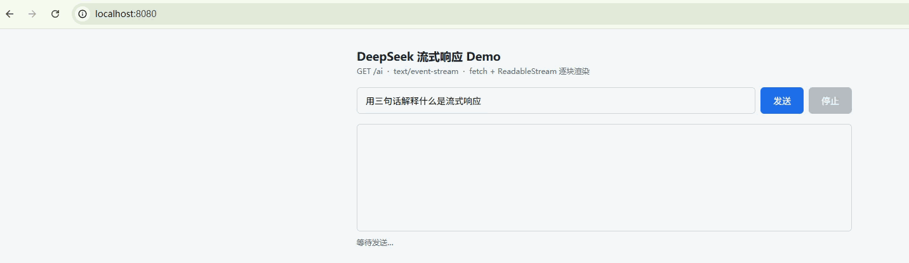

# 流式输出
## 一个简单的流式响应
使用`ChatClient`的`stream()`方法获得流式响应

有三种返回：
- content() - Flux<String>：返回文本
- chatResponse() - Flux<ChatResponse>：返回带元数据，比如token使用量等
- chatClientResponse() - Flux<ChatClientResponse>：返回带advisors调用上下文

Spring AI只负责吐出一个Flux\<>响应，要接入到页面实现流式输出要借助Spring Web的SSE实现

Spring MVC简化了这一过程，只要后端返回的是`Flux<>`，并且接口上标注了`produces = MediaType.TEXT_EVENT_STREAM_VALUE`，Spring MVC就会把它当成流式处理

但是仅仅后端流式输出是不够的，前端也要用流式接收再呈现

```java
@RestController
public class MyController {

    private ChatClient chatClient;

    public MyController(ChatClient.Builder builder) {
        this.chatClient = builder.build();
    }

    @GetMapping(value = "/ai", produces = MediaType.TEXT_EVENT_STREAM_VALUE)
    public Flux<String> generate(@RequestParam("userInput") String userInput) {
        return chatClient.prompt()
                .user(userInput)
                .stream()
                .content();
    }

}
```

模型输出：
```text
data:Why

data: did

data: the

data: scare

data:crow

data: win

data: an

data: award

data:?
data:
data:

data:Because

data: he

data: was

data: outstanding

data: in

data: his

data: field

data:.

```

像这样一个data一个data呈现的就是流式输出，而一口气呈现的则不是流式输出

结合前端，先写一个简单的前端页面：
[index.html](../resources/index.html)

调用接口：


## 流式+结构化输出
目前Spring AI 2.0并不支持这一实现，需要先把流式返回的内容聚合起来，再做结构化输出，也就是说框架会阻塞流式响应，直到所有内容都返回再一并吐给调用方

```java
@RestController
public class MyController {
    private ChatClient chatClient;

    public MyController(ChatClient.Builder builder) {
        this.chatClient = builder.build();
    }

    @PostMapping("/ai")
    public List<ActorsFilms> generate() {
        var converter = new BeanOutputConverter<>(new ParameterizedTypeReference<List<ActorsFilms>>() {
        });

        Flux<String> flux = chatClient.prompt()
                .user(u -> u.text("""
                                  Generate the filmography for a random actor.
                                  {format}
                                """)
                        .param("format", converter.getFormat()))
                .stream()
                .content();

        String content = flux.collectList().block().stream().collect(Collectors.joining());

        return converter.convert(content);

    }

}
```

输出：
```text
[
    {
        "movies": [
            "Splash",
            "Big",
            "Philadelphia",
            "Forrest Gump",
            "Apollo 13",
            "Toy Story",
            "Saving Private Ryan",
            "You've Got Mail",
            "Cast Away",
            "Road to Perdition",
            "Catch Me If You Can",
            "The Terminal",
            "The Polar Express",
            "The Da Vinci Code",
            "Captain Phillips",
            "Saving Mr. Banks",
            "Bridge of Spies",
            "Sully",
            "The Post",
            "Toy Story 4",
            "A Beautiful Day in the Neighborhood",
            "News of the World",
            "Elvis",
            "A Man Called Otto",
            "Here"
        ],
        "actor": "Tom Hanks"
    }
]
```