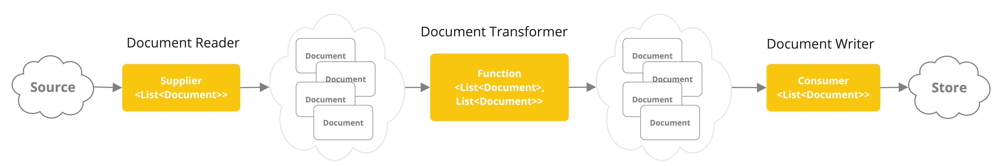
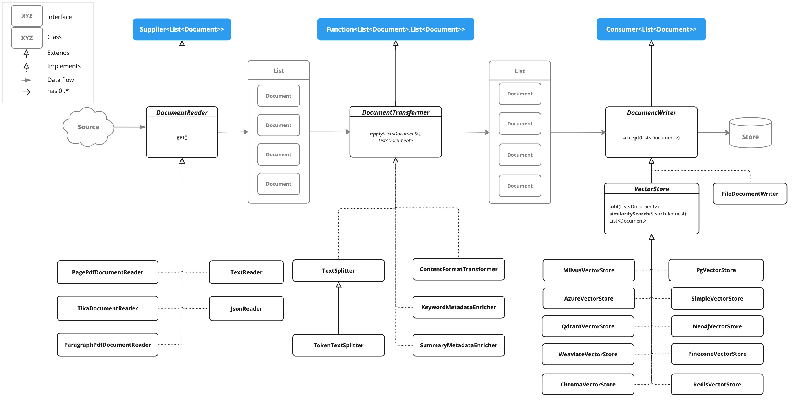

# ETL
- E：Extract，提取,
- T：Transform，转换
- L：Load，加载

ETL流水线是RAG中的一项重要流程，用于RAG前期的检索工作

# 核心API
- `Document`：文档
- `DocumentReader`：文档读取
- `DocumentTransformer`：文档转换
- `DocumentWriter`：文档写入

ETL流水线流程：


ETL常见类图：


## DocumentReader
### JSON
核心API：`JsonReader`

其构造函数中包含三个参数：
- `Resource`：资源，属于`org.springframework.core.io.Resource`包下的
- `String... jsonKeysToUse`：需要提取的jsonKeys
- `JsonMetadataGenerator`：文档元数据生成器

提取文档主要是`get()`方法和`get(String pointer)`方法，前者从整个文档中提取，后者从指定的json节点提取

代码示例：
MyJsonReader：
```java
@Component
public class MyJsonReader {

    private Resource resource;

    public MyJsonReader(@Value("classpath:reader/bikes.json") Resource resource) {
        this.resource = resource;
    }

    public List<Document> loadJsonAsDocuments() {
        JsonReader jsonReader = new JsonReader(this.resource, "description", "content");
        return jsonReader.get();
    }

    public List<Document> loadJsonAsDocumentsByPointer() {
        JsonReader jsonReader = new JsonReader(this.resource, "description");
        return jsonReader.get("/bikes/0");
    }
}
```

MyController：
```java
@RestController
public class MyController {

    private MyJsonReader myJsonReader;

    public MyController(MyJsonReader myJsonReader) {
        this.myJsonReader = myJsonReader;
    }

    @GetMapping(value = "/ai")
    public Map<String, List<Document>> generate() {
        return Map.of("default", myJsonReader.loadJsonAsDocuments(), "pointer", myJsonReader.loadJsonAsDocumentsByPointer());
    }

}
```

模型输出：
```text
{
    "pointer": [
        {
            "id": "d719a88e-1df0-4fe3-b77a-d828e8e7325c",
            "media": null,
            "metadata": {},
            "score": null,
            "text": "description: A high-performance mountain bike for trail riding.\r\n"
        }
    ],
    "default": [
        {
            "id": "11a1c3ac-2b29-496f-8e94-795dda0131fc",
            "media": null,
            "metadata": {},
            "score": null,
            "text": "{bikes=[{id=1, brand=Trek, description=A high-performance mountain bike for trail riding.}, {id=2, brand=Cannondale, description=An aerodynamic road bike for racing enthusiasts.}]}"
        }
    ]
}
```

### Text
核心API：`TextReader`

其构造函数中包含三个参数：
- `Resource`：资源，属于`org.springframework.core.io.Resource`包下的
- `String resourceUrl`：资源链接url

包含两个元数据设置方法：
- `setCharset()`：设置文本字符集
- `getCustomMetadata()`：添加额外的自定义元数据

提取文档主要是`get()`方法，一次性读取整个文档

代码示例：
MyTextReader：
```java
@Component
public class MyTextReader {
    private Resource resource;

    public MyTextReader(@Value("classpath:reader/text-source.txt") Resource resource) {
        this.resource = resource;
    }

    public List<Document> loadText() {
        TextReader textReader = new TextReader(this.resource);
        textReader.setCharset(Charset.defaultCharset());
        textReader.getCustomMetadata().put("filename", "text-source.txt");
        return textReader.get();
    }
}
```

MyController：
```java
@RestController
public class MyController {

    private MyTextReader myTextReader;

    public MyController(MyTextReader myTextReader) {
        this.myTextReader = myTextReader;
    }

    @GetMapping(value = "/ai")
    public List<Document> generate() {
        return myTextReader.loadText();
    }

}
```

模型输出：
```text
[
    {
        "id": "91f45af1-eb92-4631-9247-4041b8291c74",
        "media": null,
        "metadata": {
            "charset": "UTF-8",
            "filename": "text-source.txt",
            "source": "text-source.txt"
        },
        "score": null,
        "text": "Merida is a globally renowned bicycle brand."
    }
]
```

### HTML
核心API：`JsoupDocumentReader`

其构造函数中包含三个参数：
- `Resource`：资源，属于`org.springframework.core.io.Resource`包下的
- `JsoupDocumentReaderConfig`：用于配置需要从html页面中提取哪些元素

提取文档主要是`get()`方法，如果没有配置JsoupDocumentReaderConfig，则是读取整个页面，否则，读取JsoupDocumentReaderConfig配置的字段

要引入依赖：
```xml
<dependency>
    <groupId>org.springframework.ai</groupId>
    <artifactId>spring-ai-jsoup-document-reader</artifactId>
</dependency>
```

代码示例：
MyHtmlReader：
```java
@Component
public class MyHtmlReader {
    private Resource resource;

    public MyHtmlReader(@Value("classpath:reader/my-page.html") Resource resource) {
        this.resource = resource;
    }

    public List<Document> loadHtml() {
        JsoupDocumentReaderConfig jsoupDocumentReaderConfig = JsoupDocumentReaderConfig.builder()
                .selector("article p")
                .charset("ISO-8859-1")
                .includeLinkUrls(true)
                .metadataTags(List.of("author", "date"))
                .additionalMetadata("source", "my-page.html")
                .build();

        JsoupDocumentReader jsoupDocumentReader = new JsoupDocumentReader(this.resource, jsoupDocumentReaderConfig);
        return jsoupDocumentReader.get();
    }
}
```

MyController：
```java
@RestController
public class MyController {

    private MyHtmlReader myHtmlReader;

    public MyController(MyHtmlReader myHtmlReader) {
        this.myHtmlReader = myHtmlReader;
    }

    @GetMapping(value = "/ai")
    public List<Document> generate() {
        return myHtmlReader.loadHtml();
    }

}
```

模型输出：
```text
[
    {
        "id": "33cf06f7-e052-4e19-bc0d-e1a1c3238a7a",
        "media": null,
        "metadata": {
            "date": "2024-01-15",
            "linkUrls": [
                "",
                "",
                "https://www.example.com"
            ],
            "source": "my-page.html",
            "title": "My Web Page",
            "author": "John Doe"
        },
        "score": null,
        "text": "This is the main content of my web page.\nIt contains multiple paragraphs."
    }
]
```

如果是用：
```java
JsoupDocumentReader jsoupDocumentReader = new JsoupDocumentReader(this.resource);
```

则模型输出为：
```text
[
    {
        "id": "0eb27430-c663-4720-8b13-e0985eec2299",
        "media": null,
        "metadata": {
            "keywords": "spring, ai, html, example",
            "title": "My Web Page",
            "description": "A sample web page for Spring AI"
        },
        "score": null,
        "text": "Welcome to My Page Home About Main Content This is the main content of my web page. It contains multiple paragraphs. External Link © 2024 John Doe"
    }
]
```

从上到下列举出所有文字

### Markdown
核心API：`MarkdownDocumentReader`

其构造函数中包含三个参数：
- `Resource`：资源，属于`org.springframework.core.io.Resource`包下的
- `MarkdownDocumentReaderConfig`：用于配置需要从markdown文档中提取哪些元素

提取文档主要是`get()`方法，如果没有配置MarkdownDocumentReaderConfig，则是读取整个文档，否则，读取MarkdownDocumentReaderConfig配置的字段

要引入依赖：
```xml
<dependency>
    <groupId>org.springframework.ai</groupId>
    <artifactId>spring-ai-jsoup-document-reader</artifactId>
</dependency>
```

代码示例：
MyMarkdownReader：
```java
@Component
public class MyMarkdownReader {
    private Resource resource;

    public MyMarkdownReader(@Value("classpath:reader/code.md") Resource resource) {
        this.resource = resource;
    }

    public List<Document> loadMarkdown() {
        MarkdownDocumentReaderConfig markdownDocumentReaderConfig = MarkdownDocumentReaderConfig.builder()
                .withHorizontalRuleCreateDocument(true)
                .withIncludeBlockquote(false)
                .withIncludeCodeBlock(false)
                .withAdditionalMetadata("filename", "code.md")
                .build();

        MarkdownDocumentReader markdownDocumentReader = new MarkdownDocumentReader(this.resource, markdownDocumentReaderConfig);
        return markdownDocumentReader.get();
    }
}
```

MyController：
```java
@RestController
public class MyController {

    private MyMarkdownReader myMarkdownReader;

    public MyController(MyMarkdownReader myMarkdownReader) {
        this.myMarkdownReader = myMarkdownReader;
    }

    @GetMapping(value = "/ai")
    public List<Document> generate() {
        return myMarkdownReader.loadHtml();
    }

}
```

模型输出：
```text
[
    {
        "id": "0f74b5ef-ddd4-43ce-9c46-58a2ae56fa45",
        "media": null,
        "metadata": {
            "filename": "code.md"
        },
        "score": null,
        "text": "This is a Java sample application:"
    },
    {
        "id": "0c80ec19-eaaf-4b50-85f0-158d66835007",
        "media": null,
        "metadata": {
            "category": "code_block",
            "lang": "java",
            "filename": "code.md"
        },
        "score": null,
        "text": "package com.example.demo;\n\nimport org.springframework.boot.SpringApplication;\nimport org.springframework.boot.autoconfigure.SpringBootApplication;\n\n@SpringBootApplication\npublic class DemoApplication {\n    public static void main(String[] args) {\n        SpringApplication.run(DemoApplication.class, args);\n    }\n}\n"
    },
    {
        "id": "e51951c4-2874-4fbf-b22b-5a0f585b4d21",
        "media": null,
        "metadata": {
            "category": "code_inline",
            "filename": "code.md"
        },
        "score": null,
        "text": "Markdown also provides the possibility to use inline code formatting throughout the entire sentence."
    },
    {
        "id": "9dc1392f-4d1c-4ea3-97b4-046e170a2e33",
        "media": null,
        "metadata": {
            "filename": "code.md"
        },
        "score": null,
        "text": "Another possibility is to set block code without specific highlighting:"
    },
    {
        "id": "6dd7af52-9e70-464c-9ddf-d34e1a631a8d",
        "media": null,
        "metadata": {
            "category": "code_block",
            "lang": "",
            "filename": "code.md"
        },
        "score": null,
        "text": "./mvnw spring-javaformat:apply\n"
    }
]
```

### PDF
核心API：`PagePdfDocumentReader`

其构造函数中包含三个参数：
- `String resourceUrl`：pdf资源链接url
- `Resource`：资源，属于`org.springframework.core.io.Resource`包下的
- `PdfDocumentReaderConfig`：用于配置需要从pdf文档中提取哪些元素

提取文档主要是`get()`方法，如果没有配置PdfDocumentReaderConfig，则是读取整个文档，否则，读取PdfDocumentReaderConfig配置的字段

要引入依赖：
```xml
<dependency>
    <groupId>org.springframework.ai</groupId>
    <artifactId>spring-ai-pdf-document-reader</artifactId>
</dependency>
```

代码示例：
MyPagePdfDocumentReader：
```java
@Component
public class MyPagePdfDocumentReader {
    private Resource resource;

    public MyPagePdfDocumentReader(@Value("classpath:reader/my-pdf.pdf") Resource resource) {
        this.resource = resource;
    }

    public List<Document> getDocsFromPdf() {
        PdfDocumentReaderConfig pdfDocumentReaderConfig = PdfDocumentReaderConfig.builder()
                .withPageTopMargin(0)
                .withPageExtractedTextFormatter(ExtractedTextFormatter.builder()
                        .withNumberOfTopTextLinesToDelete(0)
                        .build())
                .withPagesPerDocument(1)
                .build();

        PagePdfDocumentReader pagePdfDocumentReader = new PagePdfDocumentReader(this.resource, pdfDocumentReaderConfig);
        return pagePdfDocumentReader.get();
    }
}
```

MyController：
```java
@RestController
public class MyController {

    private MyPagePdfDocumentReader myPagePdfDocumentReader;

    public MyController(MyPagePdfDocumentReader myPagePdfDocumentReader) {
        this.myPagePdfDocumentReader = myPagePdfDocumentReader;
    }

    @GetMapping(value = "/ai")
    public List<Document> generate() {
        return myPagePdfDocumentReader.getDocsFromPdf();
    }

}
```

模型输出：
```text
[
    {
        "id": "4084bdad-22d7-40a4-8a55-121440107fab",
        "media": null,
        "metadata": {
            "page_number": 1,
            "file_name": "my-pdf.pdf"
        },
        "score": null,
        "text": "\n               订单与物流测试数据                                                                                                                                                                                        \n\n               文档编号      TEST-2026-10，用于验证文档读取与检索链路。以下内容为虚构样例数据。                                                                                                                                                \n\n               一、文档摘要                                                                                                                                                                                           \n\n               本测试文档共           3 页，包含两笔订单的完整信息：订单                          A123                                                                                                                                \n               为山地自行车订单，已进入配送环节，物流显示已到达广东省深圳市；订单                                                       A456                                                                                                     \n               为公路自行车订单，目前处于待发货状态。两笔订单的金额、下单时间与当前状态见下表。                                                                                                                                                         \n\n               二、订单明细                                                                                                                                                                                           \n\n                 订单号           商品名称                                        下单时间                      金额（元）            当前状态                                                                                      \n\n                 A123          山地自行车        Trek Marlin 5                  2026-10-08   09:12        3280.00          待收货                                                                                       \n\n                 A456          公路自行车        Cannondale   CAAD13            2026-10-09   14:35        8999.00          待发货                                                                                       \n\n               三、字段说明                                                                                                                                                                                           \n\n                 字段              含义                                                              示例                                                                                                             \n\n                 订单号             唯一标识一笔订单的编号，查询订单与物流时使用                                          A123                                                                                                           \n\n                 商品名称            订单内商品的完整名称                                                      山地自行车       Trek Marlin 5                                                                                      \n\n                 下单时间            订单创建时间，格式为              yyyy-MM-dd    HH:mm                     2026-10-08   09:12                                                                                             \n\n                 金额              订单实付金额，单位为元                                                     3280.00                                                                                                        \n\n                 当前状态            订单在当前时刻的处理状态                                                    待收货                                                                                                            \n\n               说明：订单状态由订单系统提供，物流节点由承运方回传，两者可能存在数分钟的时间差，属正常现                                                                                                                                                     \n               象。                                                                                                                                                                                               \n\n               本页标识     PAGE-1，用于验证按页抽取的结果是否正确。                                                                                                                                                                 \n\n              订单与物流测试数据          - 仅供接口调试使用                                                                            第  1 页 / 共 3 页                                                                           \n"
    },
    {
        "id": "cba4baf3-3e97-4bfa-88f0-6ec91172973f",
        "media": null,
        "metadata": {
            "page_number": 2,
            "file_name": "my-pdf.pdf"
        },
        "score": null,
        "text": "\n               四、物流跟踪记录                                                                                                                                                                                         \n\n               下表列出两笔订单的物流节点。订单                           A123  已完成揽收与干线运输，正在派送中；订单                                A456                                                                                         \n               尚未出库，因此只有一条待发货记录。                                                                                                                                                                                \n\n                 订单号           时间                         物流节点               说明                                                                                                                                 \n\n                 A123          2026-10-08   18:40         已揽收                商家已发货，快递员已取件                                                                                                                       \n\n                 A123          2026-10-09   07:20         运输中                已离开广东省广州市分拨中心                                                                                                                      \n\n                 A123          2026-10-10   09:05         派送中                快递已到达广东省深圳市                                                                                                                        \n\n                 A456          2026-10-09   15:02         待发货                商品正在仓库备货                                                                                                                           \n\n               五、物流时效参考                                                                                                                                                                                         \n\n                 承运方式                 覆盖范围                                              参考时效                                                                                                                    \n\n                 标准快递                 全国大部分地区                                           2 至  4 天                                                                                                                \n\n                 次日达                  省会城市之间                                            1 天                                                                                                                     \n\n                 同城配送                 同一城市范围内                                           当日送达                                                                                                                    \n\n               六、查询口径说明                                                                                                                                                                                         \n\n               订单状态查询使用订单号作为唯一入参，物流查询同样以订单号为准。当查询结果返回“订单不存在”或                                                                                                                                                   \n               “物流信息不存在”时，通常表示订单号有误，建议核对后重新查询。若订单号正确但仍无结果，需确认                                                                                                                                                   \n               该订单是否已完成归档。                                                                                                                                                                                      \n\n               本页标识     PAGE-2，用于验证按页抽取的结果是否正确。                                                                                                                                                                 \n\n              订单与物流测试数据          - 仅供接口调试使用                                                                            第  2 页 / 共 3 页                                                                           \n"
    },
    {
        "id": "7ad13cce-02cb-4b35-941c-34c6bffc8116",
        "media": null,
        "metadata": {
            "page_number": 3,
            "file_name": "my-pdf.pdf"
        },
        "score": null,
        "text": "\n               七、常见问题                                                                                                                                                                                           \n\n               问：物流信息多久更新一次？                                                                                                                                                                                    \n\n               答：承运方通常每              2 至  4 小时回传一次节点，高峰期可能延迟。                                                                                                                                                   \n\n               问：订单状态显示待收货，但物流没有更新？                                                                                                                                                                             \n\n               答：订单状态与物流节点由不同系统同步，短暂不一致属正常情况。                                                                                                                                                                   \n\n               问：可以取消待发货的订单吗？                                                                                                                                                                                   \n\n               答：订单       A456   处于待发货状态，可按平台规则直接取消。                                                                                                                                                            \n\n               八、版本记录                                                                                                                                                                                           \n\n                 版本              日期                      说明                                                                                                                                                     \n\n                 v1.0            2026-10-08              首次编写，包含订单明细与物流记录                                                                                                                                       \n\n                 v1.1            2026-10-12              补充字段说明与物流时效参考                                                                                                                                          \n\n               九、备注                                                                                                                                                                                             \n\n               本文档仅用于本地接口联调，其中的订单号、金额与时间均为虚构数据，请勿用于任何生产环境或对                                                                                                                                                     \n               外展示。如需扩充测试数据，可在保持字段结构不变的前提下追加订单。                                                                                                                                                                 \n\n               本页标识     PAGE-3，用于验证按页抽取的结果是否正确。                                                                                                                                                                 \n\n              订单与物流测试数据          - 仅供接口调试使用                                                                            第  3 页 / 共 3 页                                                                           \n"
    }
]
```

### Tika（DOCX、PPTX、HTML......）
核心API：`TikaDocumentReader`

其构造函数中包含三个参数：
- `String resourceUrl`：pdf资源链接url
- `Resource`：资源，属于`org.springframework.core.io.Resource`包下的
- `ExtractedTextFormatter`：提取文本格式
- `ContentHandler`：文本处理器

提取文档主要是`get()`方法

要引入依赖：
```xml
<dependency>
    <groupId>org.springframework.ai</groupId>
    <artifactId>spring-ai-tika-document-reader</artifactId>
</dependency>
```

代码示例：
MyTikaDocumentReader：
```java
@Component
public class MyTikaDocumentReader {
    private Resource resource;

    public MyTikaDocumentReader(@Value("classpath:reader/word-sample.docx") Resource resource) {
        this.resource = resource;
    }

    public List<Document> loadText() {
        TikaDocumentReader tikaDocumentReader = new TikaDocumentReader(this.resource);
        return tikaDocumentReader.get();
    }
}
```

MyController：
```java
@RestController
public class MyController {

    private MyTikaDocumentReader myTikaDocumentReader;

    public MyController(MyTikaDocumentReader myTikaDocumentReader) {
        this.myTikaDocumentReader = myTikaDocumentReader;
    }

    @GetMapping(value = "/ai")
    public List<Document> generate() {
        return myTikaDocumentReader.loadText();
    }

}
```

模型输出：
```text
[
    {
        "id": "48351a91-8fe0-43bc-9cba-7c5568a6a262",
        "media": null,
        "metadata": {
            "source": "word-sample.docx"
        },
        "score": null,
        "text": "这是一个示例word\n"
    }
]
```

## 什么时候该用哪种
- Word/PPT：使用Tika，原生支持，但是保留结构差，容易变形
- 扫描版PDF：都不行，因为`PagePdfDocumentReader`只提取文字，要用OCR
- 按页组织的PDF手册：使用`PagePdfDocumentReader`，天然支持
- Markdown技术文档：使用`MarkdownDocumentReader`
- JSON：`JsonReader`
- Text：`TextReader`
- HTML：`JsoupDocumentReader`

## Transformers
### TextSplitter
用于切分文本

### TokenTextSplitter
用于按token长度切分

其方法含义如下：
- withChunkSize：每块的目标token数
- withMinChunkSizeChars：每块的最小字符数（注意是字符不是token）
- withMaxNumChunks：拆分的最大块大小，超出的会被丢弃
- withMinChunkLengthToEmbed：包含区块的最小长度，如果切分出来的某一段文字长度小于该值，会被直接丢弃
- withEncodingType：编码类型
- withKeepSeparator：是否包含分隔符

需要注意的是：`TokenTextSplitter`是按照标点符号来切分的，比如按照`\n`，那么识别到一行文字末尾，如果该行文字的token数小于chunk size，那么这一行就被单独列为一块，然后从下一行开始另一块；而如果大于chunk size，则会将这一行文字拆分成两块。

所以在非英文场景需要重点关注标点符号的设置

示例：
MyTokenTextSplitter：
```java
@Component
public class MyTokenTextSplitter {
    public List<Document> splitDocuments(List<Document> documents) {
        TokenTextSplitter tokenTextSplitter = TokenTextSplitter.builder().build();
        return tokenTextSplitter.split(documents);
    }

    public List<Document> splitCustomized(List<Document> documents) {
        TokenTextSplitter tokenTextSplitter = TokenTextSplitter.builder()
                .withChunkSize(1000)
                .withMinChunkSizeChars(400)
                .withMinChunkLengthToEmbed(10)
                .withMaxNumChunks(5000)
                .withKeepSeparator(true)
                .build();
        return tokenTextSplitter.split(documents);
    }
}
```

MyController：
```java
@RestController
public class MyController {
    @Autowired
    private MyJsonReader myJsonReader;

    @Autowired
    private MyTokenTextSplitter myTokenTextSplitter;

    @GetMapping("/ai")
    public List<Document> generate() {
        List<Document> documents = myJsonReader.loadJsonAsDocuments();
        return myTokenTextSplitter.splitCustomized(documents);
    }
}
```

测试文件：
[bikes-1500char.json](../resources/bikes-1500char.json)

模型输出：
```text
[
    {
        "id": "c933148d-ce4e-4775-b826-d1e64f488393",
        "media": null,
        "metadata": {
            "chunk_index": 0,
            "total_chunks": 1,
            "parent_document_id": "fdd8b5c7-0f73-4c6f-b400-d3d12a02a9f2"
        },
        "score": null,
        "text": "{bikes=[{id=1, brand=Trek, description=A high-performance mountain bike for trail riding, built with a carbon fiber frame., country=America}, {id=2, brand=Cannondale, description=A hand-built hybrid bike for daily commuting, built with a titanium frame., country=Taiwan}, {id=3, brand=Giant, description=A lightweight touring bike for multi-day trips, built with a bamboo frame., country=China}, {id=4, brand=Specialized, description=A commuter-ready cargo bike for carrying heavy loads, built with a steel frame., country=Netherlands}, {id=5, brand=Scott, description=An all-terrain gravel bike for mixed-surface touring, built with a chromoly frame., country=Canada}, {id=6, brand=Merida, description=A tour-tested folding bike for city travel, built with an aluminum frame., country=Italy}, {id=7, brand=Bianchi, description=An entry-level kids bike for young riders, built with a magnesium frame., country=France}, {id=8, brand=Canyon, description=A durable folding bike for city travel, built with a bamboo frame that is fast, light and sturdy., country=Switzerland}]}"
    }
]
```

### ContentFormatTransformer
确保所有文档格式统一

