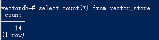

# Spring AI对接pgvector
## 安装pgvector
首先按照如下教程在windows上安装docker及pgvector

[https://github.com/muyimuLi/enviroments-setup/blob/main/docs/Windows-Docker-pgvector-%E5%AE%89%E8%A3%85%E6%8C%87%E5%8D%97.md](https://github.com/muyimuLi/enviroments-setup/blob/main/docs/Windows-Docker-pgvector-%E5%AE%89%E8%A3%85%E6%8C%87%E5%8D%97.md)

## 配置pom.xml
添加如下依赖：
```xml
<dependency>
    <groupId>org.springframework.ai</groupId>
    <artifactId>spring-ai-starter-vector-store-pgvector</artifactId>
</dependency>
```

## 配置application.yaml
```yaml
spring:
  application:
    name: ai-rag
  profiles:
    active: qianwen
  datasource:
    url: jdbc:postgresql://localhost:5432/vectordb
    username: postgres
    password: postgres
  sql:
    init:
      mode: always
  ai:
    vectorstore:
      pgvector:
        index-type: HNSW
        distance-type: COSINE_DISTANCE
        dimensions: 1024
        max-document-batch-size: 10000
        initialize-schema: false
        schema-validation: true
```

其中：
- `spring.datasource.url`：pgvector的连接地址，后面的vectordb为建的库
- `spring.ai.vectorstore.pgvector.dimensions`：维度，必须在建表时就与模型一致
- `spring.ai.vectorstore.pgvector.initialize-schema`：如果是true，Spring AI会自动新建schema；如果是false，则不会
- `spring.ai.vectorstore.pgvector.schema-validation`：验证schema.sql中的维度是否和实际pgvector库中的表维度一致

关于`initialize-schema`，如果想要人为控制建表语句，则要：
1. 将其值设为false
2. 在resources目录下新建一个`schema.sql`，里面添加建表语句，Spring AI会自动检测是否有该文件并执行
3. 在`application.yaml`里配置`spring.sql.init.mode=always`

如果设为true的话，Spring AI会执行其自身加上`schema.sql`两次。这种方式也有一个弊端，就是每次重启都会执行sql，但是好在sql语句里判断了`IF NOT EXISTS`，所以不会删表重建

当然，生产环境上还是建议用`flyway`等自动控制方式

## 注入VectorStore
代码示例：
MyMarkdownReader：
```java
@Component
public class MyMarkdownReader {
    private Resource resource;

    public MyMarkdownReader(@Value("classpath:reader/fanren-xiuxian-zhuan.md") Resource resource) {
        this.resource = resource;
    }

    public List<Document> loadMarkdown() {
        MarkdownDocumentReaderConfig markdownDocumentReaderConfig = MarkdownDocumentReaderConfig.builder()
                .withHorizontalRuleCreateDocument(true)
                .withIncludeBlockquote(false)
                .withIncludeCodeBlock(false)
                .withAdditionalMetadata("filename", "code.md")
                .build();

        MarkdownDocumentReader markdownDocumentReader = new MarkdownDocumentReader(this.resource, markdownDocumentReaderConfig);
        return markdownDocumentReader.get();
    }
}
```

MyTokenTextSplitter：
```java
@Component
public class MyTokenTextSplitter {
    public List<Document> splitDocuments(List<Document> documents) {
        TokenTextSplitter tokenTextSplitter = TokenTextSplitter.builder().build();
        return tokenTextSplitter.split(documents);
    }

    public List<Document> splitCustomized(List<Document> documents) {
        TokenTextSplitter tokenTextSplitter = TokenTextSplitter.builder()
                .withChunkSize(1000)
                .withMinChunkSizeChars(400)
                .withMinChunkLengthToEmbed(10)
                .withMaxNumChunks(5000)
                .withKeepSeparator(true)
                .build();
        return tokenTextSplitter.split(documents);
    }
}
```

EmbeddingService：
```java
@Service
public class EmbeddingService {
    @Autowired
    private PgVectorStore pgVectorStore;

    @Autowired
    private MyMarkdownReader myMarkdownReader;

    @Autowired
    private MyTokenTextSplitter myTokenTextSplitter;

    public List<Document> loadDocuments() {
        List<Document> documents = myMarkdownReader.loadMarkdown();
        return myTokenTextSplitter.splitDocuments(documents);
    }

    public void storeDocuments(List<Document> documents) {
        pgVectorStore.add(documents);
    }
}
```

EmbeddingController：
```java
@RestController
public class EmbeddingController {
    @Autowired
    private EmbeddingService embeddingService;

    @PostMapping("/ai/embedding/store")
    public void storeDocuments() {
        List<Document> documents = embeddingService.loadDocuments();
        embeddingService.storeDocuments(documents);
    }
}
```

schema.sql：
```sql
CREATE EXTENSION IF NOT EXISTS vector;
CREATE EXTENSION IF NOT EXISTS hstore;
CREATE EXTENSION IF NOT EXISTS "uuid-ossp";

CREATE TABLE IF NOT EXISTS vector_store (
    id        uuid DEFAULT uuid_generate_v4() PRIMARY KEY,
    content   text,
    metadata  json,
    embedding vector(1024)
    );

CREATE INDEX IF NOT EXISTS spring_ai_vector_index
    ON vector_store USING hnsw (embedding vector_cosine_ops);

```

调用接口：
```text
http://localhost:8080/ai/embedding/store
```

再在数据库中查询语句是否插入成功：
```text
# 进入容器
docker exec -it pgvector psql -U postgres -d vectordb

# 查询数据
select count(*) from vector_store;
```

查询结果：
