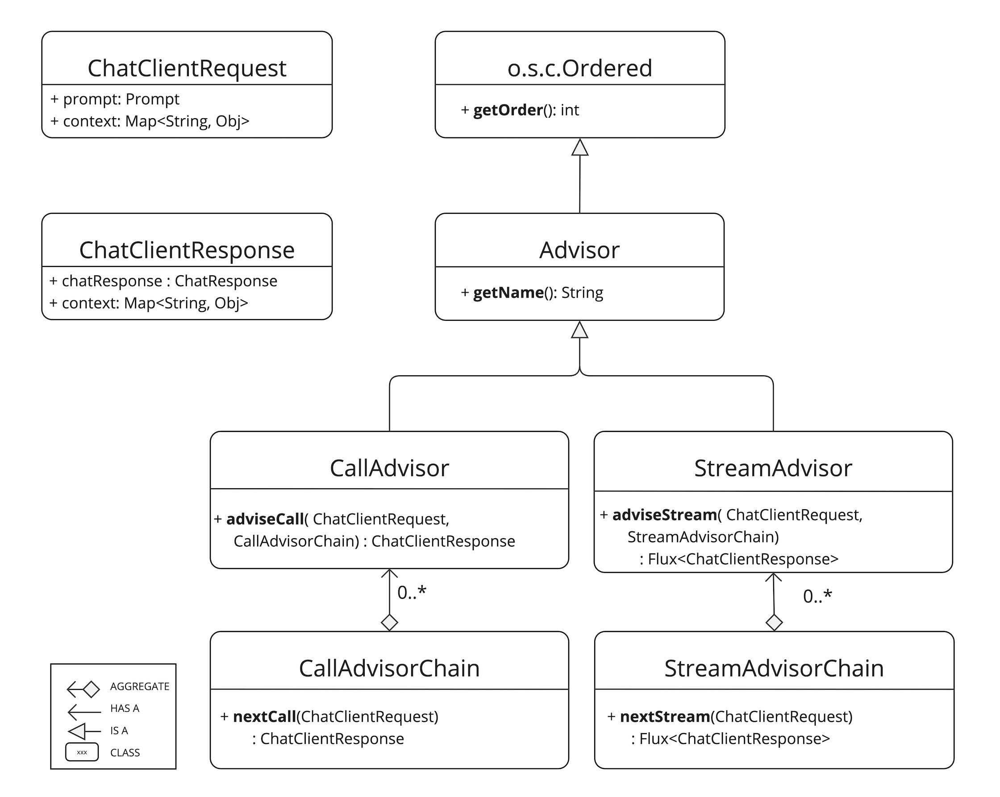
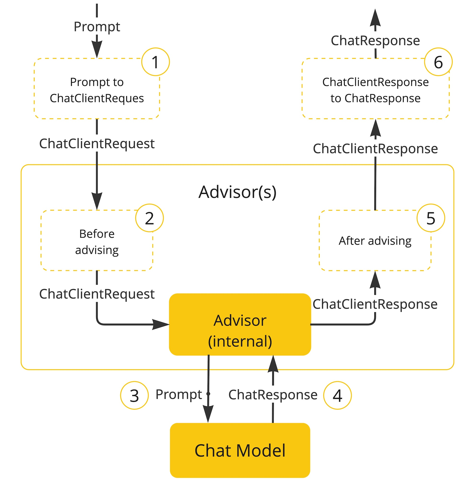

# 顾问
Advisors API用于拦截、修改、增强Spring AI中的AI驱动，可理解为Spring中的切面概念

在`ChatClient`中注册顾问并在`call()`时使用顾问

```java
ChatMemory chatMemory = ... // Initialize your chat memory store
VectorStore vectorStore = ... // Initialize your vector store

var chatClient = ChatClient.builder(chatModel)
    .defaultAdvisors(
        MessageChatMemoryAdvisor.builder(chatMemory).build(), // chat-memory advisor
        QuestionAnswerAdvisor.builder(vectorStore).build()    // RAG advisor
    )
    .build();

var conversationId = "678";

String response = this.chatClient.prompt()
    // Set advisor parameters at runtime
    .advisors(advisor -> advisor.param(ChatMemory.CONVERSATION_ID, conversationId))
    .user(userText)
    .call()
	.content();
```

## 核心组成部分
- CallAdvisor：同步调用顾问
- StreamAdvisor：流式调用顾问
- CallAdvisorChain：同步调用顾问链
- StreamAdvisorChain：流式调用顾问链



- adviseCall()：同步顾问调用方法
- adviseStream()：流式顾问调用方法
- nextCall()：调用非流式顾问链中下一个顾问
- nextStream()：调用流式顾问链中下一个顾问
- getOrder()：顾问链的执行顺序
  - 顺序值越小，优先级越高，在请求链中越先执行，在返回链中越后执行
  - 顺序值越大，优先级越低，在请求链中越后执行，在返回链中越前执行
  - 如果顺序值相同，则顺序无法保证
- getName()：顾问的名称



顾问执行步骤如下：
1. Spring AI根据提示词生成`ChatClientRequest`对象
2. 顾问链中的顾问对`ChatClientRequest`进行加工
3. 将加工后的提示词传递给模型
4. 模型做出响应，生成`ChatResponse`对象
5. 顾问链中的顾问对`ChatResponse`进行加工，生成`ChatClientResponse`
6. 输出最终结果

## 示例
### 日志顾问
MyLoggerAdvisor：
```java
@Component
public class MyLoggerAdvisor implements CallAdvisor, StreamAdvisor {
    private static final Logger logger = LoggerFactory.getLogger(MyLoggerAdvisor.class);

    @Override
    public ChatClientResponse adviseCall(ChatClientRequest chatClientRequest, CallAdvisorChain callAdvisorChain) {
        logger.info("request: {}", chatClientRequest);
        ChatClientResponse chatClientResponse = callAdvisorChain.nextCall(chatClientRequest);
        logger.info("response: {}", chatClientResponse);
        return chatClientResponse;
    }

    @Override
    public Flux<ChatClientResponse> adviseStream(ChatClientRequest chatClientRequest, StreamAdvisorChain streamAdvisorChain) {
        logger.info("request: {}", chatClientRequest);
        Flux<ChatClientResponse> chatClientResponseFlux = streamAdvisorChain.nextStream(chatClientRequest)
                .doOnNext(chatClientResponse -> logger.info("chunk: {}", chatClientResponse.chatResponse().getResult().getOutput().getText()))
                .doOnComplete(() -> logger.info("response complete"));
        return chatClientResponseFlux;
    }

    @Override
    public String getName() {
        return this.getClass().getSimpleName();
    }

    @Override
    public int getOrder() {
        return 0;
    }
}
```

注意上述代码中流式输出时的日志，因为Flux是一块一块返回的，所以在每一次返回之后记录日志

将MyLoggerAdvisor注册到ChatClient中：
```java
@Configuration
public class ChatClientConfig {
    @Bean
    public ChatClient chatClient(ChatClient.Builder builder, MyLoggerAdvisor advisor) {
        return builder.defaultOptions(OpenAiChatOptions.builder().model("deepseek-flash").temperature(0.7))
                .defaultAdvisors(advisor)
                .build();
    }
}
```

本次使用非流式演示，输出结果：
```text
一个程序员去面试，面试官问：“你毕业才两年，这三年工作经验是怎么来的？”程序员答：“加班。”
```

再看日志：
```text
2026-10-11T20:49:36.899+08:00  INFO 10348 --- [ai-demo] [nio-8080-exec-2] c.l.a.i.advisor.MyLoggerAdvisor          : request: ChatClientRequest[prompt=Prompt{messages=[UserMessage{content='讲个笑话', metadata={messageType=USER}, messageType=USER}], modelOptions=org.springframework.ai.openai.OpenAiChatOptions@711de966}, context={}]
2026-10-11T20:49:38.601+08:00  INFO 10348 --- [ai-demo] [nio-8080-exec-2] c.l.a.i.advisor.MyLoggerAdvisor          : response: ChatClientResponse[chatResponse=ChatResponse [metadata={ id: 6be97a68-36b0-4b5c-9405-7fb3b3694013, usage: DefaultUsage{promptTokens=33, completionTokens=140, totalTokens=173, cacheReadInputTokens=0}, rateLimit: org.springframework.ai.chat.metadata.EmptyRateLimit@408aaf6c }, generations=[Generation[assistantMessage=AssistantMessage [messageType=ASSISTANT, toolCalls=[], textContent=一个程序员去面试，面试官问：“你毕业才两年，这三年工作经验是怎么来的？”程序员答：“加班。”, metadata={role=assistant, messageType=ASSISTANT, finishReason=STOP, refusal=, annotations=[{}], index=0, id=6be97a68-36b0-4b5c-9405-7fb3b3694013, reasoningContent=用户要求讲个笑话，这是个简单直接的请求。需要提供一个简短有趣的笑话，最好能让人会心一笑。可以选一个经典的笑话类型，比如谐音梗或者生活场景类的。想到一个关于程序员的笑话，既符合现代生活，又有点幽默感。用“为什么程序员分不清万圣节和圣诞节”这个梗，因为Oct 31等于Dec 25这个巧合在编程语境下特别有趣。这个笑话应该能引起共鸣，尤其是对科技领域的人。直接给出笑话内容即可，不需要额外解释。}], chatGenerationMetadata=DefaultChatGenerationMetadata[finishReason='STOP', filters=0, metadata=0]]]], context={}]
```

说明顾问生效了

### 重读顾问
```java
@Component
public class MyReReadingAdvisor implements BaseAdvisor {
    private static final String DEFAULT_RE2_ADVISE_TEMPLATE = """
            {re2_input_query}
            Read the question again: {re2_input_query}
            """;

    private final String re2AdviseTemplate;

    private int order = 0;

    public MyReReadingAdvisor() {
        this(DEFAULT_RE2_ADVISE_TEMPLATE);
    }

    public MyReReadingAdvisor(String re2AdviseTemplate) {
        this.re2AdviseTemplate = re2AdviseTemplate;
    }

    @Override
    public ChatClientResponse adviseCall(ChatClientRequest chatClientRequest, CallAdvisorChain callAdvisorChain) {
        return BaseAdvisor.super.adviseCall(chatClientRequest, callAdvisorChain);
    }

    @Override
    public Flux<ChatClientResponse> adviseStream(ChatClientRequest chatClientRequest, StreamAdvisorChain streamAdvisorChain) {
        return BaseAdvisor.super.adviseStream(chatClientRequest, streamAdvisorChain);
    }

    @Override
    public String getName() {
        return BaseAdvisor.super.getName();
    }

    @Override
    public ChatClientRequest before(ChatClientRequest chatClientRequest, AdvisorChain advisorChain) {
        String augmentedUserText = PromptTemplate.builder()
                .template(this.re2AdviseTemplate)
                .variables(Map.of("re2_input_query", chatClientRequest.prompt().getUserMessage().getText()))
                .build()
                .render();
        return chatClientRequest.mutate()
                .prompt(chatClientRequest.prompt().augmentSystemMessage(augmentedUserText))
                .build();
    }

    @Override
    public ChatClientResponse after(ChatClientResponse chatClientResponse, AdvisorChain advisorChain) {
        return chatClientResponse;
    }

    @Override
    public int getOrder() {
        return this.order;
    }
}
```

### Spring AI内置顾问
- MessageChatMemoryAdvisor：聊天记忆顾问
- VectorStoreChatMemoryAdvisor：向量存储顾问
- QuestionAnswerAdvisor：问答顾问
- RetrievalAugmentationAdvisor：检索增强生成顾问
- ReReadingAdvisor：重读顾问
- ToolCallingAdvisor：工具调用顾问
- SafeGuardAdvisor：安全内容顾问

## 最佳做法
1. 让顾问专注于具体一件事情
2. 必要时使用`advisorContext`在多个顾问间共享顾问上下文
3. 同时实现流式与非流式以达到最大兼容性
4. 严格设计顾问链的执行顺序

## 流式
```java
@Override
public Flux<ChatClientResponse> adviseStream(ChatClientRequest chatClientRequest, StreamAdvisorChain chain) {

    return  Mono.just(chatClientRequest)
            .publishOn(Schedulers.boundedElastic())
            .map(request -> {
                // This can be executed by blocking and non-blocking Threads.
                // Advisor before next section
            })
            .flatMapMany(request -> chain.nextStream(request))
            .map(response -> {
                // Advisor after next section
            });
}
```