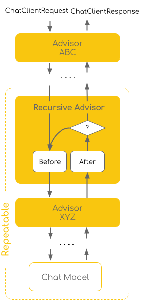

# 递归顾问
递归顾问可以循环调用下游顾问链，适用于需要多次调用LLM直到满足特定条件时的情景



它可以用于：
- 在循环中多次使用工具调用
- 验证结构化输出并重试
- 对请求进行评估重试
- 实现重试逻辑并对请求进行修改

使用`CallAdvisorChain.copy(CallAdvisor after)`来创建顾问链，它包含指定顾问之后的顾问，并允许递归顾问多次循环调用
- 递归顾问可以多次循环链中其他顾问
- 链中其他顾问可以观察并拦截迭代
- 递归顾问不能调用之前的顾问

要注意一个误区，递归顾问还是一个顾问，它做的只是把原顾问链复制一份并重走一遍流程，直到模型返回的结果满足条件为止

因为一般的链只会走一遍，如果模型响应不符合结果也会返回，而递归顾问可以保证模型返回必然符合结果

示例：
```java
@Component
public class MyRecursiveAdvisor implements CallAdvisor {
    private static final Integer MAX_ROUND = 3;

    @Override
    public ChatClientResponse adviseCall(ChatClientRequest chatClientRequest, CallAdvisorChain callAdvisorChain) {
        ChatClientResponse chatClientResponse = null;
        for (Integer i = 0; i < MAX_ROUND; i++) {
            chatClientResponse = callAdvisorChain.copy(this).nextCall(chatClientRequest);
            String feedback = chatClientResponse.chatResponse().getResult().getOutput().getText();
            // 满足递归条件
            if (feedback.contains("ok")) {
                return chatClientResponse;
            }

            // 否则继续循环
            chatClientRequest.mutate()
                    .prompt(chatClientRequest.prompt().augmentSystemMessage("上一轮的答复：" + feedback))
                    .build();
        }
        return chatClientResponse;
    }

    @Override
    public String getName() {
        return this.getClass().getSimpleName();
    }

    @Override
    public int getOrder() {
        return 0;
    }
}
```

注册递归顾问的方式和注册普通顾问一致：
```java
@Bean
    public ChatClient chatClient(ChatClient.Builder builder, MyRecursiveAdvisor advisor) {
        return builder.defaultOptions(OpenAiChatOptions.builder().model("deepseek-flash").temperature(0.7))
                .defaultAdvisors(advisor)
                .build();
    }
```

## 内置递归顾问
### ToolCallingAdvisor
工具调用顾问

```java
var toolCallingAdvisor = ToolCallingAdvisor.builder()
    .toolCallingManager(toolCallingManager)
    .advisorOrder(BaseAdvisor.HIGHEST_PRECEDENCE + 300)
    .build();

var chatClient = ChatClient.builder(chatModel)
    .defaultAdvisors(toolCallingAdvisor)
    .build();
```

### StructuredOutputValidationAdvisor
结构化输出验证顾问
```java
var validationAdvisor = StructuredOutputValidationAdvisor.builder()
    .outputType(MyResponseType.class)
    .maxRepeatAttempts(3)
    .build();

var chatClient = ChatClient.builder(chatModel)
    .defaultAdvisors(validationAdvisor)
    .build();
```