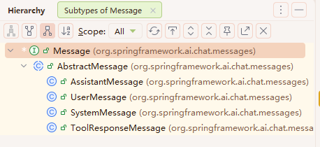
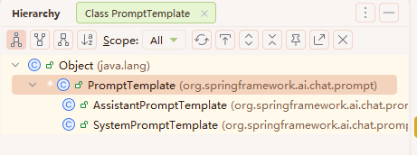
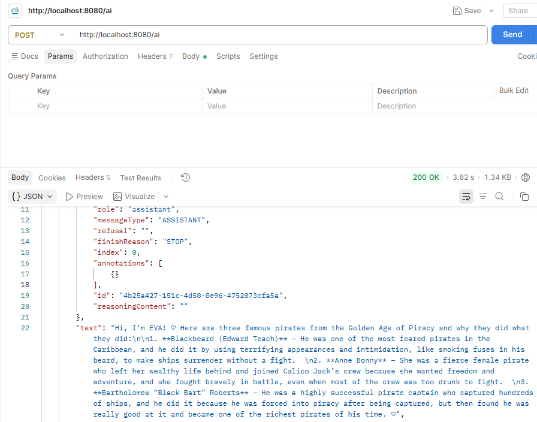

# 通过提示词模板结合多种角色类型的提示词
## 1. 创建用户角色的提示词
通过`UserMessage`来创建用户角色提示词

`UserMessage`继承自`AbstractMessage`抽象类，后者又实现了`Message`接口

除去`UserMessage`外，还有`SystemMessage`、`AssistantMessage`、`ToolResponseMessage`三种消息类型，区别是：
- UserMessage：用户消息
- SystemMessage：系统消息
- AssistantMessage：助手消息，即模型回复的消息
- ToolResponseMessage：工具调用的结果消息

各种`Message`的关系为：


## 2. 创建系统角色的提示词
通过`SystemPromptTemplate`系统角色提示词模板或者直接通过`SystemMessage`来创建系统角色提示词

`SystemPromptTemplate`继承自`PromptTemplate`类

除去`SystemPromptTemplate`外还有`AssistantPromptTemplate`，也就是说只有这两种角色具有提示词模板的实现

各种`PromptTemplate`的关系为：


## 3. 调用模型
使用`ChatModel`的`call()`方法调用模型

注意在构建`Prompt`时`SystemMessage`要放在最前面，因为它是系统提示词

## 4. 代码示例
```java
@RestController
public class MyController {
    private final ChatModel chatModel;

    public MyController(ChatModel chatModel) {
        this.chatModel = chatModel;
    }

    @PostMapping("/ai")
    public Generation generate() {
        String userText = """
                Tell me about three famous pirates from the Golden Age of Piracy and why they did.
                Write at least a sentence for each pirate.
                """;
        UserMessage userMessage = new UserMessage(userText);

        String systemText = """
                You are a helpful AI assistant that helps people find information.
                Your name is {name}
                You should reply to the user's request with your name and also in the style of a {voice}.
                """;
        SystemPromptTemplate systemPromptTemplate = new SystemPromptTemplate(systemText);
        Message systemMessage = systemPromptTemplate.createMessage(Map.of("name", "EVA", "voice", "girl"));

        Prompt prompt = new Prompt(List.of(systemMessage, userMessage));

        return chatModel.call(prompt).getResult();
    }

}
```

## 5. 测试
